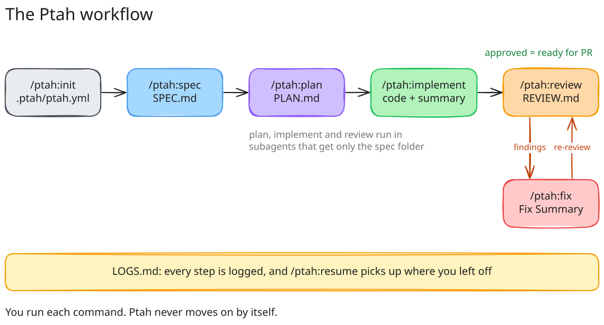

<p align="center">
  
</p>

<h1 align="center">Ptah</h1>

<p align="center"><b>Conceived as a spec. Spoken into code.</b></p>

> [!NOTE]
> Ptah is a work in progress. Skills, files and config can change at any time.

In Egyptian mythology, Ptah is the creator god of Memphis, patron of craftsmen, architects and builders. According to the myth, he brought the world into being by conceiving it in his heart and speaking it with his tongue. Ptah, the workflow, does the same with your code: every feature is conceived as a spec, takes shape in a plan, and comes into being by the hand of an agent.

Ptah is a Claude Code plugin. You write a spec, and Ptah plans, implements, reviews and fixes it one step at a time. Every step leaves a file you can read in `.ptah/specs/<spec>/`.



## Install

```sh
git clone https://github.com/angelsebamc/ptah.git
cd your-project
claude --plugin-dir /path/to/ptah
```

## Use

Run these inside Claude Code, in your project:

| Command | What it does | Writes |
|---------|--------------|--------|
| `/ptah:init` | One-time setup: fix defaults, whether `/ptah:implement` runs the review, and your ticket server (optional) | `.ptah/ptah.yml` |
| `/ptah:spec [ticket]` | Grills you about the feature, looking facts up in the code, then writes the spec. Pass a ticket id or URL to start from it. | `SPEC.md` |
| `/ptah:plan` | Writes the technical plan | `PLAN.md` |
| `/ptah:implement` | Writes the code from the plan | code + `IMPLEMENTATION-SUMMARY.md` |
| `/ptah:review` | Reviews the code on three axes in parallel, each in a fresh context: spec, standards, correctness. Findings are defects or judgements; the review is `approved` when there are no defects. | `REVIEW.md` |
| `/ptah:fix` | Fixes every review finding, or only the codes you name, then run `/ptah:review` again (optional after an `approved` review, which only leaves judgements to fix) | Fix Summary in `REVIEW.md` |
| `/ptah:resume` | Shows where a spec stands | nothing |

When a review comes back `approved`, the work is ready for a PR.

You can leave out the spec id: Ptah takes it from your git branch, or asks you to pick one. If you're not on the spec's branch, Ptah offers to switch to it, or to create it when it doesn't exist yet.

Everything that happens is logged in the spec's `LOGS.md`. Starting a new session? Run `/ptah:resume`.

## Principles

- **Every step leaves a file.** The ticket, `SPEC.md`, `PLAN.md`, the code with `IMPLEMENTATION-SUMMARY.md`, and `REVIEW.md` are the audit trail, tied together by `LOGS.md`. Steps share nothing but the spec folder and the code, so you can read exactly what each one worked from.
- **Commands are building blocks, not a pipeline.** Run any one, in any order, as often as you need. Each checks that what it needs exists.
- **A command runs another only when your config allows it.** `/ptah:implement` runs `/ptah:review` when `.ptah/ptah.yml` says so; otherwise every command ends by naming the next one.
- **Reviews start fresh.** The reviewers see only `SPEC.md` and the code, never the plan, the implementer's summary, or the conversation that wrote it, so they can't inherit the reasons the code was written that way.
- **Fail loudly.** A command stops when something it needs is missing (the previous step's file, the ticket, the ticket server, a valid result from its agent) instead of guessing past it.
