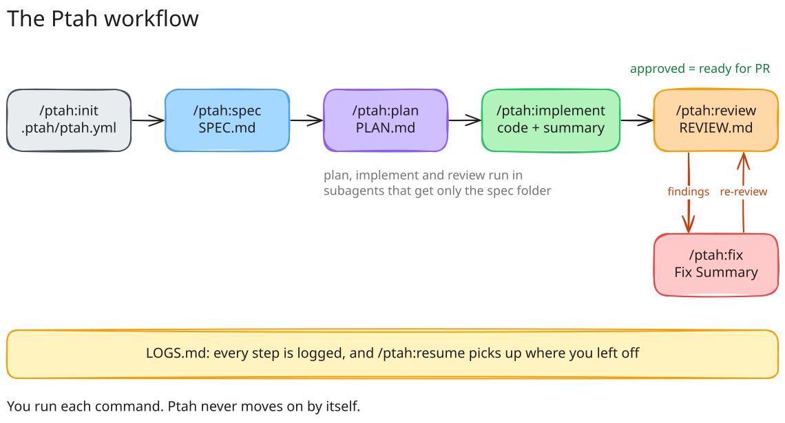

<p align="center">
  
</p>

<h1 align="center">Ptah</h1>

<p align="center"><b>Conceived as a spec. Spoken into code.</b></p>

> [!NOTE]
> Ptah is a work in progress. Skills, files and config can change at any time.

In Egyptian mythology, Ptah is the creator god of Memphis, patron of craftsmen, architects and builders. According to the myth, he brought the world into being by conceiving it in his heart and speaking it with his tongue. Ptah, the workflow, does the same with your code: every feature is conceived as a spec, takes shape in a plan, and comes into being by the hand of an agent.

Ptah is a Claude Code plugin. You write a spec, and Ptah plans, implements, reviews and fixes it one step at a time. Every step leaves a file you can read in `.ptah/specs/<spec>/`.



## Install

```sh
git clone https://github.com/angelsebamc/ptah.git
cd your-project
claude --plugin-dir /path/to/ptah
```

## Use

Run these inside Claude Code, in your project:

| Command | What it does | Writes |
|---------|--------------|--------|
| `/ptah:init` | One-time setup: fix defaults and your ticket server (optional) | `.ptah/ptah.yml` |
| `/ptah:spec [ticket]` | Asks you questions, one at a time, to write the spec. Pass a ticket id or URL to pre-fill it. | `SPEC.md` |
| `/ptah:plan` | Writes the technical plan | `PLAN.md` |
| `/ptah:implement` | Writes the code from the plan | code + `IMPLEMENTATION-SUMMARY.md` |
| `/ptah:review` | Reviews the code in a fresh context | `REVIEW.md` |
| `/ptah:fix` | Fixes the review findings, then run `/ptah:review` again | Fix Summary in `REVIEW.md` |
| `/ptah:resume` | Shows where a spec stands | nothing |

Ptah never moves on by itself: each command ends by telling you the next one to run. When a review comes back `approved`, the work is ready for a PR.

You can leave out the spec id: Ptah takes it from your git branch, or asks you to pick one. If you're not on the spec's branch, Ptah offers to switch to it, or to create it when it doesn't exist yet.

Everything that happens is logged in the spec's `LOGS.md`. Starting a new session? Run `/ptah:resume`.
